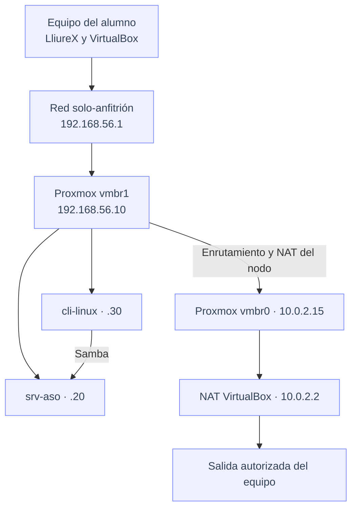

# 02-diagrama-red

## Objetivo
Diseñar una red de laboratorio para conectar el nodo Proxmox,
el servidor ASO y el cliente Linux de forma controlada.

## 1. Tabla de direccionamiento

| Elemento | Nombre | IP | Función | Recursos |
|---|---|---|---|---|
|Interfaz solo-anfitrión del host| Host-only | 192.168.56.1/24 | Navegador, SSH y Ansible hacia el laboratorio | VM |
| Nodo Proxmox Adaptador1 NAT | vmbr0 | 10.0.2.15/24 |   Red exterior | VM |
| Gateway NAT de VirtualBox | - | 10.0.2.2  | Salida al exterior permitido | VM |
| DNS NAT de VirtualBox | - | 10.0.2.3  | Resolución | VM |
| Nodo Proxmox Adaptador2 | vmbr1 | 192.168.56.10/24 | Administración y gateway invitados | VM |
| Servidor ASO | srv-aso | 192.168.56.24/24 | Servicio principal | VM |
| Cliente | cli-linux | 192.168.56.34/24 | pruebas | VM |

Nombre del nodo Proxmox: vmbr0, vmbr1
Interfaz de gestion: vmbr1
Bridge de Proxmox: vmbr0
Red o VLAN de laboratorio: 192.168.56.0/24
IPs de las VMs/LXC: 192.168.56.24/24, 192.168.56.34/24
Gateway: 10.0.2.2
DNS: 10.0.2.3
Puertos necesarios: 00560
Medidas de aislamiento: NAT

## 2. Diagrama de red

## 3. Aislamiento y seguridad

## Conclusion

[Volver al indice](../README.md)
